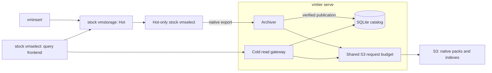

# vmtier

Archive older VictoriaMetrics samples to S3-compatible storage and query Hot and
Cold data through an unmodified stock vmselect.

vmtier is an independent, Apache-2.0-licensed project, not an official
VictoriaMetrics product. It is **under development**: the SQLite service works
end to end in local differential tests, with scoped workload and recovery
measurements. Real S3 providers and production deployment conditions still need
qualification.

## How it works

`vmtier serve` runs an age-based archiver, a SQLite catalog, and a vmstorage-compatible
read gateway in one process. Stock vmselect evaluates MetricsQL across Hot
vmstorage and the Cold gateway.

Compatibility is pinned to **VictoriaMetrics OSS v1.155.0-cluster**, commit
[`cab3d5fbeeedd5d0374c1dabde93939af4c2499c`](https://github.com/VictoriaMetrics/VictoriaMetrics/tree/cab3d5fbeeedd5d0374c1dabde93939af4c2499c).
Other versions and single-node VictoriaMetrics are outside the validated scope.
Existing catalogs and packs with the previous VM pin cannot be opened by this
version; follow the [upgrade procedure](docs/compatibility.md#codec-and-upgrades)
before changing a deployment.



The archiver checks native exports against an independent raw-data query and
verifies uploaded objects before publishing coverage. SQLite on persistent local
storage is the authority for committed windows. S3 needs ordinary PUT, GET, and
Range GET; conditional PUT, ETags, and LIST are not required. The gateway decodes,
clips, and rebuilds blocks for stock vmselect on reads. SQLite archive windows
can span multiple bounded packs; the reader uses LRU caching, shared concurrent
reads, adjacent Range GETs, and bounded query admission.

## Get started

On Linux with Go, Python 3, a C toolchain, and curl installed:
```sh
git clone https://github.com/yuuki/vmtier.git
cd vmtier
make bootstrap build
.bin/vmtier version
```

See [Getting started](docs/getting-started.md) for exact prerequisites and a
self-contained local demo with disposable stock VM processes. For an existing
cluster, follow the [service guide](docs/serve.md) and [configuration examples](examples/README.md).
Run [capacity preflight](docs/preflight.md) on representative busy windows before
initializing the catalog. Configuration requires an explicit coverage origin and
an externally enforced lateness policy before startup. `inspect` and `verify`
support SQLite as offline commands; stop `serve` before using them or the
[catalog maintenance commands](docs/sqlite-catalog.md). Standalone `archive` and
`gateway` commands remain JSON v2 tools and reject SQLite configurations.

## Operating boundaries

- Run one service owner with persistent local SQLite state. There is no HA or
  automatic failover. Catalog loss cannot be repaired from an S3 listing alone;
  [offline backup and restore](docs/sqlite-catalog.md) are provided.
- Enforce bounded lateness on every ingestion path. With archive age H, lateness L,
  Hot retention R, and window width W, require `H > L >= 0` and
  `R > H + safety_margin + W`. vmtier does not shorten Hot retention or prevent
  data loss during an unbounded outage.
- Tenants, sources, coverage origin, and window policy are fixed by the catalog.
  Guaranteed history begins at `coverage_start_ms`; missing required Cold coverage
  fails the query. Hot and Cold are complementary nodes, so both must participate
  in queries with partial responses disabled.
- Pack rotation keeps objects bounded; whole-window input, physical sample counts,
  and query work still have limits. Query admission is logical accounting, not a
  process RSS ceiling. See [architecture and limits](docs/architecture.md),
  [memory accounting](docs/query-memory.md), and the [measured local workload](docs/workload-validation.md).
- Compaction, GC, Cold TTL, backfill, deletion, multipart upload, and downsampling
  are not implemented.
- Keep RPC and HTTP endpoints on trusted networks. Restrict mutation APIs upstream.
  S3 request limits cover a bucket only when the service is its sole client.

Local and Moto-backed tests cover exact query results, metadata, restart,
publication, and failure behavior. Separate local runs cover offline recovery,
87,600 catalog windows, and a conditional ten-tenant/5,000-series-per-tenant
workload with two dense hours and two Hot replicas; the larger 10,000-series
target exceeded the default query budget.
These measurements do not establish real Sakura/AWS compatibility, universal
production throughput, or natural retention-expiry behavior.
[Validation records](docs/README.md#validation-records) identify each tested revision
and its limits.

## Documentation and contributing

- [Documentation index](docs/README.md) — guides, references, designs, and evidence.
- [Service operation](docs/serve.md) — configuration, scheduling, monitoring, and shutdown.
- [Architecture](docs/architecture.md) and [compatibility](docs/compatibility.md) — current implementation and protocol boundaries.
- [Contributing](CONTRIBUTING.md) and [testing](docs/testing.md) — development setup, checks, and pull requests.
- [First-release roadmap](docs/design.md) — remaining implementation and qualification work.
- [Legacy JSON v2 operation](docs/operations.md) — retained separate-process commands and migration context.

The project uses the [Apache License 2.0](LICENSE). See [NOTICE](NOTICE) and
[third-party notices](THIRD_PARTY_NOTICES.md) for attribution and redistribution
requirements. Repository documentation and code comments are written in English.
