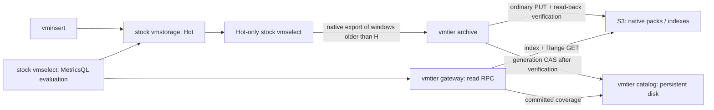

# vmtier

**Archive older VictoriaMetrics samples to S3-compatible storage and query Hot and Cold data through an unmodified stock vmselect.** vmtier is an independent, Apache-2.0-licensed OSS project, not an official VictoriaMetrics product.

The current implementation is a reproducible MVP. The [first-release design](docs/design.md) describes planned work; the [MVP design](docs/mvp-design.md), commands below, and [validation report](docs/validation.md) describe what exists today.

Compatibility is pinned to **VictoriaMetrics OSS v1.128.0-cluster**, commit [`9a009c491da4c17531893ab4acb6a5f1b5e0eaf2`](https://github.com/VictoriaMetrics/VictoriaMetrics/tree/9a009c491da4c17531893ab4acb6a5f1b5e0eaf2). Other versions' native codecs and read RPCs have not been validated.



Stock vmselect evaluates expressions. The gateway returns raw blocks, preserving native portable payloads at rest and decoding, clipping, and rebuilding wire blocks when reading. This is not a decode-free path. Hot and Cold provide complementary time coverage, so the query frontend must not skip either node as a redundant replica.

**S3 conditional PUT and ETags are not required.** S3 stores payloads and indexes through ordinary PUT, GET, and Range GET. A separate catalog service owns publication order and generation conflicts on persistent local storage. This supports the project's requirement to work without conditional PUT on Sakura Object Storage. Connections to the actual Sakura service have not yet been tested.

## Reproduce the MVP

Requirements: Linux amd64, Go **1.27.3** (the tested version; minimum 1.25.3), Python 3.12 or newer, a C toolchain, curl, and approximately 2 GB of free disk space. Docker is not required. These commands use disposable local VM processes and a Moto S3 test backend.

```sh
./scripts/bootstrap.sh
make build test stock
python3 -m venv .deps/e2e-venv
. .deps/e2e-venv/bin/activate
python -m pip install -r scripts/requirements-e2e.txt
python scripts/e2e.py --backend local --workdir .cache/demo-local
python scripts/e2e.py --backend s3 --replicas 2 --workdir .cache/demo-s3
```

If Go is installed outside `PATH`, use `make GO=/path/to/go ...`. The test environment must permit local TCP listeners.

Bootstrap downloads checksum-pinned VM sources and the SQLite driver, then generates `.deps/` and `vendor/`. It does not update unrelated modules or patch VM. The SQLite driver uses CGO and bundled SQLite. `go.mod` and `go.sum` record the pinned dependencies; generated vendor files are not tracked in Git.

The E2E harness:

1. Loads the same complete dataset into a reference VM and the Hot cluster.
2. Starts a separate catalog service and exports age-eligible windows. It compares every timestamp and value with an independent raw JSON response, checks supplementary sample counts, uploads and reads back the objects, and commits the catalog generation only after verification.
3. Confirms that a Cold-only stock vmselect reads native packs through the independent gateway.
4. **Recreates Hot in a fresh storage directory with recent samples only and checks that raw export of the old range is empty.** This does not simulate waiting for natural retention expiry.
5. Compares instant and range queries across Cold, Hot, and their boundary, plus metadata and tenant isolation, against the reference VM.
6. Tests retries, failures, and caching, and writes `results.json` and logs into the work directory.

The harness stops its processes on completion and does not connect to an existing production VM. See the [validation report](docs/validation.md) for the 720 exact query comparisons, measurements, and untested areas.

## Commands and deployment

```sh
.bin/vmtier version
.bin/vmtier catalog-init -path .state/catalog -id dev-catalog-001
.bin/vmtier catalog -path .state/catalog -id dev-catalog-001 -http 127.0.0.1:8491
# Keep the catalog running and use another shell for these commands.
.bin/vmtier archive -config config.json  # Select safe, incomplete windows automatically.
.bin/vmtier archive -config config.json -start 1791244800000 -end 1791266400000
.bin/vmtier gateway -config config.json -listen 127.0.0.1:8489 -http 127.0.0.1:8490
.bin/vmtier inspect -config config.json
.bin/vmtier verify -config config.json
```

`archive` is a one-shot command intended for an external scheduler. Without `-start` and `-end`, it selects complete windows from the catalog's contiguous coverage up to the current time minus the archive age, H. Explicit bounds use UTC epoch **milliseconds** and the half-open interval `[start,end)`. The catalog is the restart checkpoint; committed windows are not exported again. Windows that are too recent or lack retention headroom are rejected. The timestamps above illustrate the syntax and are not deployment-specific values.

Set `coverage_start_ms` in the [example configuration](examples/config.json) to the earliest time whose completeness must be guaranteed, aligned to a window boundary. Set `lateness_enforced` to `true` **only when every write path actually enforces the lateness bound**. The examples intentionally refuse to start until these deployment decisions have been made. Supply S3 credentials through `AWS_ACCESS_KEY_ID`, `AWS_SECRET_ACCESS_KEY`, and optionally `AWS_SESSION_TOKEN`, not through the configuration file. Create the bucket beforehand. A [Sakura configuration example](examples/sakura.json) is also provided.

Configure the catalog explicitly. An HTTP service uses `{"type":"http","url":"http://127.0.0.1:8491","id":"dev-catalog-001"}`. Same-host development can use `{"type":"local","path":".state/catalog","id":"dev-catalog-001"}`. `catalog-init` creates new state and refuses to overwrite an existing catalog. Normal `catalog` startup fails if state is missing; it never silently creates an empty catalog. Client and server IDs must match.

Deploy the catalog on a trusted network. An optional shared bearer token is supplied through `VMTIER_CATALOG_TOKEN`. Deployments outside loopback need TLS termination and network access controls. The catalog is a single authority with persistent storage, not an HA service: losing its disk cannot be repaired from the S3 object listing alone.

Each export source must be a Hot-only stock vmselect connected to all of that source's Hot shards. Do not archive through the combined Hot/Cold query frontend. Source IDs, URLs, and the tenant set are fixed after the first commit. Shard topology inside a source must also remain stable; the gateway cannot detect its changes.

Required query-frontend flags, with deduplication configured consistently across VM components:

```sh
.bin/vmselect -httpListenAddr=127.0.0.1:8482 \
  -storageNode=127.0.0.1:8401,127.0.0.1:8489 \
  -replicationFactor=1 -globalReplicationFactor=1 \
  -search.skipSlowReplicas=false -search.denyPartialResponse=true \
  -search.disableCache -dedup.minScrapeInterval=1ms
```

Keep the RPC listener on a trusted network. `/health` reports process liveness; `/ready` validates the catalog and required coverage. `/metrics` exposes archive lag, retention headroom, object reads, cache hits, and query errors. Use `verify` for periodic payload verification. Cold metadata is also available through the gateway.

## Guarantees and limits

- Archive age H, allowed lateness L, and Hot retention R must satisfy `H > L >= 0` and `R > H + safety_margin + window`. Hot retention does not follow vmtier's watermark. vmtier does not automatically shorten retention or delete Hot data, and cannot prevent loss during an unbounded export or storage outage.
- Lateness is an external ingestion contract. A read gateway cannot block direct late writes, backfills, or deletes. Changes to archived windows and topology changes are unsupported. Block mutation APIs with upstream access controls.
- Guaranteed query coverage begins at `coverage_start_ms`. Earlier history is outside that guarantee. Queries requiring a gap in archived coverage fail instead of returning an incomplete successful result.
- The MVP supports one archiver writer, fixed tenants, a pinned VM version, and **1 ms** deduplication. Unsupported RPCs, including Graphite, administration, writes, and deletes, return errors. Single-node VM integration is out of scope.
- Limits are 64 MiB per pack, 16 MiB per index, 10,000 series and 100,000 blocks per pack, and 10,000 catalog entries. Exceeding a limit returns an error. Window size is fixed after the first commit, so validate volume and retention duration beforehand; smaller windows increase catalog entry count. Index lookup is a bounded dictionary scan. Automatic splitting, compaction, GC, Cold TTL deletion, multipart upload, and downsampling are not implemented.
- S3 needs ordinary PUT with Content-MD5, GET, and single-range GET. Objects are read back and verified by length and SHA-256 before publication. Correctness does not depend on conditional PUT, ETags, or LIST. Storage classes requiring a restore operation before reads are unsupported. Moto and the compatibility proxy do not validate real-service authentication, durability, or performance.
- The catalog fixes coverage origin, window size, deduplication, H, L, tenants, and sources, and publishes with generation CAS. Queries fail when the authority is unavailable. The HTTP client detects generation rollback within its lifetime, but not an old backup restored after all clients restart. Restore requires a new catalog ID and an audit. Automatic migration from the old S3 catalog is not available.
- VM frontend result caching is disabled in the MVP; the immutable Cold block cache is separate. Upstream public APIs do not expose immediate cancellation on client disconnect, so backend work can continue until its deadline.

## Documentation

- [SQLite catalog foundation and offline commands](docs/sqlite-catalog.md) — implemented groundwork; runtime integration is pending.
- [First-release design and implementation plan](docs/design.md) — planned work beyond the MVP.
- [Current MVP design](docs/mvp-design.md), [native gateway decision](docs/adr/0001-native-gateway.md), and [independent catalog decision](docs/adr/0002-independent-catalog.md).
- [Compatibility](docs/compatibility.md), [operations](docs/operations.md), and [test instructions](docs/testing.md).
- [Validation results](docs/validation.md), [prior art](docs/prior-art.md), and [third-party notices](THIRD_PARTY_NOTICES.md).
- [Contributing](CONTRIBUTING.md), including English-language documentation and comment conventions.
