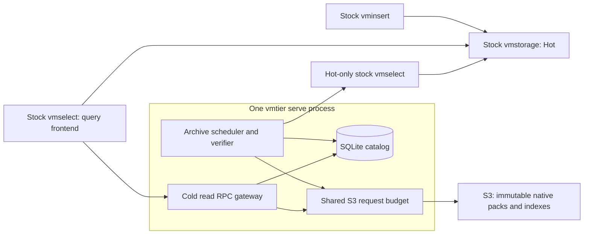

# vmtier

Archive older VictoriaMetrics samples to S3-compatible storage and query Hot and
Cold data through an unmodified stock vmselect. vmtier is an independent,
Apache-2.0-licensed project, not an official VictoriaMetrics product.

**Status: under development.** `vmtier serve` supports a single-owner SQLite
deployment or a PostgreSQL catalog with multiple Cold read gateways and one
leased, fenced archiver. Local differential, recovery, and HA tests are available;
real Sakura Object Storage, natural retention expiry, and release qualification remain open.
See [validation evidence](docs/evidence.md) for measured scope and provenance.

Compatibility is pinned to **VictoriaMetrics OSS v1.155.0-cluster**, commit
[`cab3d5fbeeedd5d0374c1dabde93939af4c2499c`](https://github.com/VictoriaMetrics/VictoriaMetrics/tree/cab3d5fbeeedd5d0374c1dabde93939af4c2499c).
Other versions' native codecs and read RPCs are unsupported; single-node VM
integration is out of scope. Catalogs and packs from the previous VM pin cannot
be opened by this version. Follow the [upgrade procedure](docs/compatibility.md#codec-and-upgrades)
before changing a deployment.

## How it works

The SQLite deployment shares one process-local S3 request budget:



The archiver verifies exported samples against an independent raw response and
reads uploaded objects back before publishing coverage. Stock vmselect evaluates
MetricsQL; the gateway reads native packs, decodes and clips samples, and rebuilds
wire blocks. SQLite stores authoritative publication state on persistent local
disk. S3 needs ordinary PUT, GET, and Range GET; conditional PUT and ETags are not
required.

With a [PostgreSQL catalog](docs/postgres-catalog.md), gateways share authoritative
metadata and the active archiver holds a database lease. An operator-managed
PostgreSQL HA endpoint and redundant Cold endpoint provide deployment redundancy;
see [HA deployment](docs/ha-deployment.md) for fencing and aggregate S3 budgets.

## Get started

Build from the repository root with Go 1.27.4, CGO and a C compiler,
Python 3.15.2, curl, and standard Linux build tools:

```sh
./scripts/bootstrap.sh
make build
.bin/vmtier version
```

Bootstrap downloads checksum-pinned stock VM sources into `.deps/`, verifies
the committed Go modules, and regenerates `vendor/`. CI uses Go 1.27.4 and Python 3.15.2 on Linux amd64.

Release archives are static `linux/amd64` binaries built in a digest-pinned
container and reproduced byte for byte by a second build. Each archive ships
with licenses, a CycloneDX SBOM, and signed provenance. See [releases](docs/releasing.md)
for verification and the support scope; no release has been published yet.

Follow [getting started](docs/getting-started.md) to run a disposable SQLite demo
or configure a service for an existing Hot cluster. It covers prerequisites,
capacity preflight, explicit catalog initialization, and query frontend setup.
The [configuration example guide](examples/README.md) explains which template to
use and which deployment values to supply.
For PostgreSQL, follow the [catalog guide](docs/postgres-catalog.md) or
[stopped-SQLite migration procedure](docs/postgres-migration.md).

## Operational boundaries

- Use one SQLite service owner, or PostgreSQL gateways with one leased archiver.
  Both require fixed tenants and sources and 1 ms deduplication.
- Enforce ingestion lateness externally. Archive age, lateness, and retention must
  satisfy the [time contract](docs/limits.md); vmtier does not delete Hot data or
  change Hot retention.
- Preserve the catalog as well as object data. S3 listings cannot reconstruct
  authoritative coverage. SQLite maintenance is offline; PostgreSQL requires
  database-native backups and coordinated failover.
- Missing required coverage and object errors fail queries. Hot and Cold are
  complementary storage nodes, so the frontend must not skip either as a replica.
- GC, Cold TTL deletion, compaction, downsampling, and backfill correction are
  not implemented. Resource budgets are not process RSS guarantees.

See [guarantees and limits](docs/limits.md) before deployment.

## Documentation and contributing

- [Documentation index](docs/README.md): guides, reference, design, and evidence.
- [Service guide](docs/serve.md) and [operations](docs/operations.md).
- [Catalog backup, restore, and migration](docs/sqlite-catalog.md).
- [PostgreSQL catalog](docs/postgres-catalog.md), [HA deployment](docs/ha-deployment.md),
  and [HA validation](docs/postgres-ha-validation.md).
- [Architecture and source map](docs/architecture.md).
- [Testing](docs/testing.md), [releases](docs/releasing.md), [contributing](CONTRIBUTING.md),
  and [security reporting](SECURITY.md).
- [Legacy JSON v2 deployment](docs/legacy-json-v2.md).

Licensed under [Apache License 2.0](LICENSE). See [NOTICE](NOTICE) and
[third-party notices](THIRD_PARTY_NOTICES.md) for dependency attribution.
