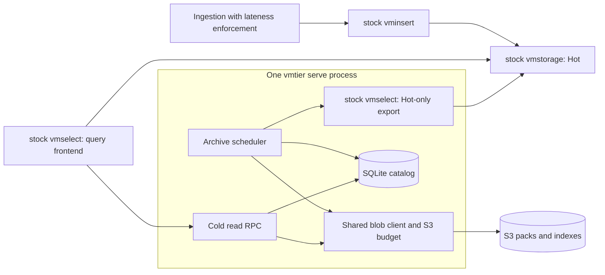

# Current architecture

This document describes the implemented SQLite `vmtier serve` runtime. For setup,
see [Getting started](getting-started.md) and the [service guide](serve.md). The
[first-release design and roadmap](design.md) describes work still to be done;
the [JSON v2 MVP design](mvp-design.md) describes the retained legacy deployment.

vmtier archives age-eligible samples from VictoriaMetrics OSS cluster to immutable
native packs and serves those samples through the vmstorage read RPC. An unmodified
stock vmselect evaluates MetricsQL over Hot vmstorage and the Cold gateway.
Compatibility is pinned to **v1.155.0-cluster**, commit
`cab3d5fbeeedd5d0374c1dabde93939af4c2499c`; other versions and single-node VM are
outside the tested integration. See [Compatibility](compatibility.md).

## Components and ownership

The service owns one catalog, one archive worker, one read gateway, and health and
metrics listeners. A lifetime lock protects its local state directory. Startup
requires an explicitly initialized catalog whose ID, immutable contract, and blob
location match the configuration. It does not create missing state automatically.

SQLite is the publication authority; S3 stores payloads and indexes. Object
existence, LIST results, ETags, and conditional PUT are not used to decide whether
a window is complete. Local filesystem blobs are also available for development.
The state-directory lock does not coordinate different hosts or directories.
There is no distributed lock, failover, or HA catalog.

The query frontend lists both Hot and Cold as storage nodes. They provide
complementary coverage, so it must not skip one as a redundant replica. The
[service guide](serve.md) gives the required flags. vmtier does not proxy Hot reads
or evaluate expressions. The archiver uses a separate Hot-only vmselect that
covers every required Hot shard for its source.

## Coverage contract

Timestamps use UTC Unix milliseconds and windows use half-open intervals
`[start,end)`. Each fixed tenant/source pair is a stream with its own contiguous
coverage end, beginning at `coverage_start_ms`. For a tenant with multiple sources,
complete coverage ends at the minimum of their coverage ends.

The configuration requires `H > L >= 0` and `R > H + safety_margin + window`, where
H is archive age, L is the maximum ingestion lateness, and R is Hot retention.
Only complete windows ending at or before `now-H` are eligible. Retention headroom
is checked before export and before publication.

The catalog fixes coverage origin, window width, H, L, 1 ms deduplication, tenants,
source IDs and URL fingerprints, and the blob locator. URL fingerprints do not
detect shard changes behind a source. Changing these settings needs an explicit
migration; increasing timeouts or cache budgets does not alter the data contract.

Ingestion must enforce lateness and keep archived windows immutable. vmtier cannot
block direct late writes, backfills, or deletion in Hot. It neither shortens Hot
retention nor prevents expiry during an unbounded outage. History before
`coverage_start_ms` is outside the completeness guarantee.

## Archive and publication path

The worker starts immediately, orders streams by coverage age, and attempts at
most one oldest eligible window per stream in each pass. Progress starts another
pass immediately; idle work and failed streams wait for `service.archive_interval`
(30 seconds by default). `service.archive_timeout` bounds one stream/window
attempt (two minutes by default). A stream failure does not stop other streams
from advancing.

For each window, the implementation:

1. Exports native blocks from the Hot-only source, rotating packs before the next
   complete record would exceed a pack's byte, index, series, or block limit.
   Every pack retains the same logical window and tenant.
2. Collects a bounded expected-sample map across packs. Each completed pack/index
   is uploaded under fresh attempt keys and read back for complete byte comparison.
   S3 uploads include Content-MD5; descriptors and blocks record SHA-256 checksums.
3. Deduplicates samples across pack boundaries with pinned VM semantics, then
   compares every series, timestamp, and value against an incrementally parsed
   independent raw JSON matrix, with supplementary count and stale-sample checks.
   Native EOF or matching counts alone are insufficient evidence of completeness.
4. Rechecks retention and commits the window, ordered pack references, stream
   coverage, and incremented generation in one SQLite transaction.

A verified empty window commits zero pack references. A nonempty window can span
multiple packs, up to 1,024. Staged objects remain invisible until the complete
window passes verification and commits. Rotation does not bypass whole-window
input, physical-sample, or deadline limits; an oversized individual record also
fails the attempt without advancing coverage. [Archive packing](archive-packs.md)
describes the bounds and the optional `max_pack_blocks` setting.

The pipeline retains one active pack and the window-wide expected-sample map;
read-back temporarily adds an object buffer. Incremental raw parsing avoids
retaining the whole JSON matrix; whole-window limits and measured memory headroom
still apply.
[Capacity preflight](preflight.md) runs the same builder and verification against
one source window without opening a catalog or writing objects. Run it on
representative busy windows before initializing the fixed window contract.

SQLite uses schema 1, foreign keys, WAL, and `synchronous=FULL`. Short metadata
transactions use one database connection; network export and blob I/O happen
outside those transactions. Publication checks the expected generation and
contiguous window boundary. Replaying an identical publication is idempotent;
different content for an already published window is rejected.

After restart, persisted coverage is the checkpoint. Uploaded objects from an
uncommitted attempt remain invisible and may become orphans. Published keys are
never reused by vmtier, but operators must also prevent external modification or
deletion. There is no object garbage collection or Cold TTL enforcement.

## Read path and storage format

The gateway receives tenant, matchers, and the actual storage time range from
vmselect, including lookbehind for range vectors, offsets, subqueries, and `@`.
It validates the catalog contract and obtains a bounded indexed plan for the
tenant/time range. The database transaction ends before object reads begin.
A query intersecting required but unarchived coverage returns an error.

Pack/index v1 retains VM portable block bytes at rest. Its JSON index records
canonical labels, logical coverage, block offsets, lengths, physical time ranges,
and checksums. The reader scans the bounded series dictionary and merges exactly
adjacent uncached block ranges within an object into GETs of at most 4 MiB, without
fetching gaps. It validates each original block, decodes samples, clips to the
logical window, and rebuilds VM wire blocks. This is not a decode-free path.
Tenant identity and VM tag ordering are preserved for Hot/Cold merging.

The byte-bounded LRU cache owns its raw bytes and accounts for keys and entry
bookkeeping. Parsed indexes are validated per query and are not cached. Concurrent
identical index/range misses share reads under a 16-flight cap; each waiter can
cancel independently. Overlapping ranges with different grouping do not share a
read. [Reader validation](reader-validation.md) describes these mechanisms and
their focused measurements.

Cached bytes never replace a required catalog check. Metadata APIs use validated
block reads and actual sample times, so broad metadata requests can be expensive
even when their response is small. The [metadata comparison](metadata-validation.md)
establishes five-second deadline success only for its retained small fixture.

The gateway reserves the complete per-query logical work allowance before backend
and matcher work. Defaults allow two 128 MiB reservations under a shared 256 MiB
allowance; excess work is refused immediately. Sample iterators retain their
reservation until close or deadline, and canceled backend work keeps it until
unwinding. Metadata releases after constructing its response, before upstream
serialization. Cache, shared-read buffers, archive work, and runtime allocations
have separate accounting; this allowance is not a process memory limit.

The gateway materializes and validates results before returning success. Missing
objects, corruption, unsupported operations/codecs, and resource-limit violations
produce errors. With partial responses disabled in vmselect, an unavailable
gateway can also fail Hot-only queries. The upstream RPC API does not expose
immediate cancellation on client disconnect; request deadlines still bound work.

## Resource boundaries

These are implementation bounds, not a universal production workload or total
memory guarantee. Representative windows must fit before catalog initialization,
because window width is immutable afterward. Query work charges encoded bytes,
physical decoded rows, copied names/bookkeeping, and the current parsed directory,
including on cache hits. See [memory accounting](query-memory.md) for definitions.

| Area | Current default or bound |
| --- | --- |
| Pack and index | 64 MiB pack; 16 MiB JSON index; 10,000 series and 100,000 blocks per pack |
| Whole-window archive | 1,024 packs; 128 MiB native input; 128 MiB raw oracle response; 5,000,000 physical samples before clipping/deduplication |
| SQLite read plan | 4,096 windows and 4,096 packs; descriptor bytes bounded by the smaller of `max_query_bytes` and 16 MiB |
| Query work | 128 MiB logical allowance per query and 256 MiB shared by default; 100,000 blocks and 100,000 series; separate 128 MiB gateway response bound |
| RPC admission | Eight active requests, no queue wait; at most 30 seconds per request |
| Immutable reads/cache | 16 shared reads; adjacent ranges up to 4 MiB; `cache_bytes` defaults to zero (disabled), maximum 256 MiB |
| SQLite S3 budget | 80 attempts/s, eight in flight, and 64 queued requests when all three limits are omitted |

The S3 budget is shared by archive uploads, verification, reads, and every SDK
retry attempt. An in-flight permit lasts until the response body closes. This
controls bucket traffic only when the service is its sole client; a dedicated
prefix does not isolate bucket-wide quotas. See [service configuration](serve.md)
for budget overrides and deadline tradeoffs.

The [local workload report](workload-validation.md) qualifies a scoped fixture:
ten tenants, 5,000 series each, 30-second samples, two dense hours, one-hour windows,
and two Hot replicas, with one 24-hour sentinel series per tenant. The original
10,000-series target exceeded the unchanged query allowance. Native block sizes
and replica overlap matter; 5,000 series is not a standalone capacity guarantee.
The combined run measured 255.117 MiB peak vmtier RSS with a 16 MiB cache, not a
recommended container limit. The separate [catalog report](catalog-capacity-validation.md)
checks 87,600 windows without claiming equivalent payload scale.

Real Sakura Object Storage, natural Hot retention expiry, enforced ingress
lateness, and reproducible release artifacts remain [qualification work](design.md).
The [offline recovery report](recovery-validation.md) covers JSON v2 cutover,
older-backup catch-up, and process crashes against stock VM and local objects;
its expired-source case reconstructs absent history and does not prove natural
retention expiry or physical power-loss durability.

## Code map and operations

| Location | Responsibility |
| --- | --- |
| [`cmd/vmtier/`](../cmd/vmtier) | CLI, service lifecycle, archive scheduling loop, preflight, health/capacity metrics, offline maintenance |
| [`internal/config/`](../internal/config) | JSON configuration, safety checks, and component construction |
| [`internal/archive/`](../internal/archive) | Native export, cross-pack verification, incremental raw oracle, preflight, upload/read-back, publication |
| [`internal/catalog/`](../internal/catalog) | SQLite schema, locking, selection, transactions, backup/restore/import; legacy JSON catalog |
| [`internal/pack/`](../internal/pack) | Native pack/index format, rotation, bounded decoding, checksum and wire-block conversion |
| [`internal/cold/`](../internal/cold) | Coverage checks, query planning/accounting, LRU/shared reads, adjacent ranges, and block selection |
| [`internal/gateway/`](../internal/gateway) | VM read RPC, shared query admission, matchers, metadata, and response limits |
| [`internal/querylimit/`](../internal/querylimit) | Bounded query-refusal reasons for errors and metrics |
| [`internal/objectstore/`](../internal/objectstore) | Local/S3 blobs, request budgeting, retries, and I/O metrics |

Keep the catalog on persistent local storage. `inspect`, `verify`, backup, restore,
and import acquire the state-directory lock and run offline with `serve` stopped.
Catalog backup is separate from object preservation; restoring older metadata
requires enough remaining Hot history to archive the missing suffix. S3 listings
cannot reconstruct lost coverage authority. See [catalog maintenance](sqlite-catalog.md)
for procedures and [Testing](testing.md) for development and differential checks.
