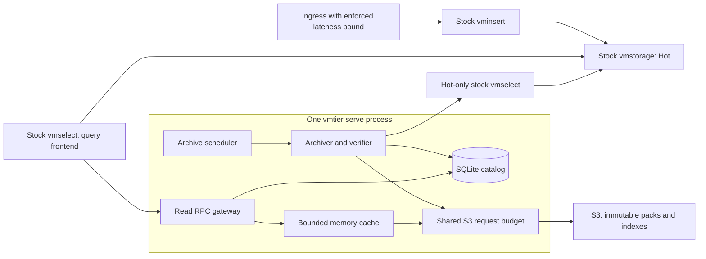

# First-release design and roadmap

For the architecture that exists today, read the [architecture and source map](architecture.md).
For deployment, use the [SQLite service guide](serve.md) or
[PostgreSQL HA guide](ha-deployment.md). This document records the target design
and delivery plan, including requirements that are not yet implemented.
The status table and delivery stages below distinguish current behavior from that
target; proposed capacity fixtures are not support claims.

The [PostgreSQL catalog and service](postgres-catalog.md) and
[ADR 0004](adr/0004-postgresql-catalog.md) extend the original single-host design
with multiple read gateways, fenced archiver ownership, and stopped SQLite
migration. The SQLite deployment described below remains available. The
[HA deployment guide](ha-deployment.md) defines the external database, endpoint,
and budget requirements; [HA evidence](postgres-ha-validation.md) retains its
recorded revision and qualification boundaries.

This is the implementation design for the first supported vmtier release. The
[SQLite catalog](sqlite-catalog.md) and [`serve` runtime](serve.md) provide
transactional per-stream publication, offline migration and recovery commands, one
owner for archival and queries, and a shared S3 request budget. Bounded archive
rotation, incremental verification, preflight, reader caching/range improvements,
and logical query admission are implemented. The design also identifies remaining
measurement and release-qualification work. See
[service validation](serve-validation.md) for runtime evidence and
[ADR 0003](adr/0003-first-release-scope.md) for the selected scope.

| Area | Current implementation |
| --- | --- |
| Catalog | SQLite schema 2 or PostgreSQL schema 3; shared repository operations, bounded indexed selection, independent stream coverage, object ledger for garbage collection; backend-specific migration/maintenance |
| Service | SQLite directory ownership or PostgreSQL fenced archiver lease; age-based scheduler, read RPC, failure metrics, per-process admission; PostgreSQL static aggregate S3 allocation |
| Archive | Shared service pack rotation within one logical window, bounded cross-pack verification, incremental raw oracle, read-only capacity preflight; zero packs for verified empty windows |
| Reader | Repository selection, byte-bounded LRU, bounded shared misses, adjacent Range GETs, logical query work admission |
| Remaining work | Broader workload and provider, retention, ingress, and release qualification; see the scoped reports below |

The legacy [JSON v2 MVP architecture](mvp-design.md) and its
[historical validation](validation.md) remain the regression baseline. Neither
those results nor the subsequent implementation work establishes release capacity
or real-provider support. The retained JSON v2 writer remains single-pack; shared
raw verification and reader improvements do not change its catalog format.

The goal remains age-based archival of existing VictoriaMetrics samples to S3,
with queries through an unmodified stock vmselect after those samples leave Hot.
The initial deployment target is one operator-managed Linux host and a dedicated
Sakura Object Storage standard-plan bucket. This is a deployment assumption, not
a claim of tested Sakura compatibility or a throughput guarantee.

## Evidence and required changes

Keep native pack/index v1 and the vmstorage-compatible read gateway. The current
pinned OSS VM release is `v1.155.0-cluster`, commit
`cab3d5fbeeedd5d0374c1dabde93939af4c2499c`. Existing catalogs with an older VM
pin require the [upgrade procedure](compatibility.md#codec-and-upgrades).

The historical local and restricted-Moto suites against `v1.128.0-cluster`, commit
`9a009c491da4c17531893ab4acb6a5f1b5e0eaf2`, passed 720 exact query comparisons
covering Hot/Cold boundaries and tenant separation, plus metadata checks. The S3
suite used no conditional requests and required no ETags. Those results establish
compatibility for that revision and fixture, not the upgraded dependencies or
production capacity. No real Sakura service was used.

| JSON v2 MVP behavior | Practical consequence | First-release change |
| --- | --- | --- |
| Complete JSON catalog read, validation, and rewrite; at most 10,000 entries | With six-hour windows, ten tenants and one source reach the entry limit in 250 days; 100 tenants reach it in 25 days | Embedded SQLite, indexed selection, persisted coverage |
| One bounded pack per tenant/source/window | A busy window exceeds the pack limit even when each native block is small | Multiple bounded packs in an atomic logical window |
| Sequential block GETs and cache-wide eviction on overflow | Repeated round trips and index downloads | Adjacent-range coalescing and a byte-bounded LRU |
| Separate archive, gateway, and maintenance clients | Independent limits cannot enforce a bucket-wide budget | One service with a shared S3 transport |
| Whole verification map plus whole decoded JSON response | Avoidable peak memory | Keep the bounded map; parse the independent oracle incrementally |

The small Moto fixture showed expensive uncached reads and effective warm caching.
It does not establish a need for postings lists, a new index format, compaction,
or a different storage format. Those changes need a measured workload first.

## SQLite deployment and ownership



The implemented `serve` command owns scheduling, catalog access, the read RPC listener,
and health/metrics endpoints. It uses one state directory on persistent local disk
and one process lock for that directory. A second process using that directory
fails at startup. This prevents accidental local double starts; it is not
leader election. This SQLite deployment has no automatic failover; PostgreSQL
provides the separately documented multi-instance option.

Initialization is explicit, after capacity preflight. `serve` only opens an
initialized catalog and rejects missing, corrupt, or wrong-ID state. Disable
SQLite's implicit create-on-open on this path so a missing volume or path typo
cannot silently create an empty authority.

The existing Go package boundaries remain. `internal/catalog` exposes domain
repository operations used by both SQLite and PostgreSQL implementations.
PostgreSQL clients connect directly to the database; no new catalog HTTP service
is introduced. The HTTP catalog and JSON local adapters remain legacy MVP and
migration tools. [ADR 0004](adr/0004-postgresql-catalog.md) records the concrete
multi-host availability requirement that extends this original single-host scope.

All S3 traffic for the bucket, including verification and maintenance, must pass
through this instance during service operation. Maintenance currently runs with
`serve` stopped; there is no online maintenance work queue. Offline commands refuse
to open a state directory owned by a live
service. Other applications sharing the bucket invalidate the bucket-wide budget;
a dedicated prefix alone does not isolate provider quotas. Operators must also
prevent starting another instance with a different state directory for that bucket.

The stock query frontend continues to fan out directly to Hot and Cold. Required
flags remain `-replicationFactor=1 -globalReplicationFactor=1`,
`-search.skipSlowReplicas=false`, `-search.denyPartialResponse=true`,
`-search.disableCache=true`, and `-dedup.minScrapeInterval=1ms`. Hot replication is
configured independently. The gateway does not proxy Hot or evaluate MetricsQL.
A stopped vmtier instance can fail Hot-only queries too. This availability tradeoff
is explicit; automatic partial-result fallback is outside the release.

## Data and time contract

All timestamps are UTC Unix milliseconds and internal intervals are `[start,end)`.
Inclusive VM endpoints receive `end-1ms`. Preserve full labels, tenant identity,
native tag ordering, block clipping, and pinned-VM duplicate/stale-value semantics.

Let `H` be archive age, `L` maximum accepted write delay, `R` actual Hot query/export
retention, `w` window width, and `s` the safety margin:

```text
H > L >= 0
R > H + s + w
eligible_end(now) = floor((now - H) / w) * w
headroom(now, coverage_end) = coverage_end + R - now
```

Only complete eligible windows are archived. Check retention before export and
again before publication. Scheduling delay, archive duration, retries, outage,
and recovery must fit remaining headroom. Configuration alone does not prove
that a deployment meets this constraint. VM retention remains independent of
vmtier; vmtier neither deletes Hot data nor changes Hot retention.
[`spec/lean/VmtierTiming.lean`](../spec/README.md#the-timing-contract-in-lean)
proves that these checks leave every window archivable for `R - H - s - w`
milliseconds, that a published window is complete, and that a query the
gateway accepts misses no accepted sample.

Freeze coverage start, `H`, `L`, `w`, dedup interval, tenants, sources, VM codec
identity, and the blob locator in the catalog contract. The blob locator includes
bucket, prefix, endpoint, and region; credentials are not part of it. Changing
these locator fields must require an explicit migration rather than silently
redirecting relative object keys. Endpoint aliases are not auto-detected.

The SQLite writer, catalog, and reader support multiple packs without changing
`w`. [Pack rotation](archive-packs.md) preserves one logical window; it cannot
bypass the whole-window native-input, physical-sample, pack-count, or time bounds.
The retained JSON v2 writer continues to enforce a single-pack bound.
Increasing archive age or allowed lateness in place remains rejected. Tenants and
sources can be added with an explicit command ([ADR 0008](adr/0008-adding-streams.md));
resharding sources or changing the rest of the fixed contract needs a future migration.
Cache budgets, S3 limits, and timeouts can change through a controlled restart.

Ingress must enforce `L` across retries, queues, imports, and direct writes. The
read gateway cannot enforce it. Writes into a published window are not automatically
added to Cold. Backfill, deletion, and tombstones remain unsupported; mutation APIs
must be restricted outside vmtier. History before coverage start is outside the
guarantee. A required Cold coverage gap returns an error, even if some of that
interval may still happen to exist in Hot.

## Catalog and publication

The details below describe SQLite persistence. PostgreSQL preserves the same
publication and selection contracts using row locking, repeatable-read snapshots,
shared object-key uniqueness, and fenced archiver ownership; see
[repository behavior](postgres-catalog.md#repository-behavior).

Use SQLite on a local filesystem, with foreign keys, WAL mode, and
`synchronous=FULL`. The implemented repository uses one connection for short
metadata transactions; S3 work runs outside those transactions. The pinned driver
is `github.com/mattn/go-sqlite3 v1.14.53`, matching the existing C toolchain
requirement, with its license recorded in [third-party notices](../THIRD_PARTY_NOTICES.md).
SQLite addresses ordinary catalog growth and atomic updates, not HA. Do not use
NFS or copy a live database file as a backup.

Reject unknown newer schema versions. Apply supported versioned migrations offline
with a backup before service startup; do not introduce a general migration framework.

| Table | Contents and constraints |
| --- | --- |
| `catalog_state` | One row: schema version, catalog ID, contract, generation |
| `coverage` | One row per tenant/source: contiguous committed end, initially coverage start |
| `windows` | Tenant, source, start, end, generation, pack count, publication digest; unique `(tenant, source, start)` |
| `packs` | Window foreign key, ordinal, data/index keys, checksums, sizes; unique `(window, ordinal)` |

Index windows by `(tenant, source, start)`. Derive both lower and upper start bounds
from fixed `w` and the query interval; only filtering by `end > query_start` can
still scan the entire history. Pack rows are separate from windows: **zero packs
can represent a verified empty window**, while ten packs still represent one
window. An object existing in S3 is never evidence of publication.

Publish atomically **per tenant/source/window**, not across all tenants. Queries
are tenant scoped; a large or failing tenant must not block others. For a tenant
with multiple sources, complete coverage is the minimum source coverage end.
Reads may include later committed source windows in the Hot overlap, but cannot
claim complete Cold coverage beyond that minimum.

The internal catalog API needs four operations: load contract/status, select a
bounded tenant/time query plan, publish one complete window, and inspect coverage.
Replace whole-manifest read/replace semantics rather than hiding SQLite behind
the current unbounded `Read`/`Publish` API. No new HTTP protocol is needed.

A publication transaction checks contract and expected generation, requires
`start == coverage_end` and `end == start+w`, inserts the window and every ordered
pack reference, advances coverage, and increments generation. Commit is the only
visibility point. Replaying the same committed window and publication digest
succeeds without inserting rows; a different digest is an error. Define the digest
over canonical tenant/source/time and the ordered pack descriptors, not over a
random serialization or the changing global generation. After a lost response or
restart, reload coverage before deciding to retry. Network export and S3 I/O never
run inside the database transaction.

A query reads identity, contract, coverage, and candidate references in one short
read transaction. Enforce candidate/plan limits during selection, then release the
transaction before S3 I/O. Referenced objects are immutable and are not deleted in
this release, so long-lived transactions and generation leases are unnecessary.
Garbage collection deletes only objects that no window ever referenced
([ADR 0006](adr/0006-orphan-garbage-collection.md)) or that Cold retention retired
long enough ago that no query still reads them ([ADR 0007](adr/0007-cold-retention.md)).
Catalog failure remains a query error, including with a warm object cache.

## Archive pipeline and bounded verification

One archive worker processes at most one oldest eligible window per tenant/source
in each pass, ordering streams by coverage age. It starts immediately and continues
catch-up immediately after progress. A failing stream receives a retry cooldown
while other streams can advance. `service.archive_interval` controls that cooldown
and idle polling, defaulting to 30 seconds; `service.archive_timeout` bounds each
window, defaulting to two minutes. A failed source is never an empty successful
window. Scheduling resumes from persisted coverage, without a separate durable job
queue; retry cooldowns are process-local. An internal one-pass operation supports
tests, while the standalone `archive` CLI remains a JSON v2 tool.

The shared service writer implements the following bounded pipeline. See
[archive packing](archive-packs.md), [incremental oracle allocation evidence](raw-oracle-validation.md),
and [capacity preflight](preflight.md) for implementation details, reproduction,
and measured limits. Stock-VM integration evidence must identify the tested
revision separately from focused unit and allocation checks.

For one tenant/source/window:

1. Check contract, coverage, eligibility, retention, and work budgets.
2. Read Hot-only native export. Build packs incrementally, rolling at byte, index,
   series, or block limits before the next complete native record. A record over
   its own bound is an error. Every pack index retains the same logical window;
   splitting does not create additional coverage.
3. Collect the bounded expected sample map across all packs. Deduplicate across
   pack boundaries with the pinned VM semantics and the same conflict/stale handling
   as the MVP. Count physical samples before dedup so replicas and repeated blocks
   cannot bypass the memory cap.
4. Compare against the independent raw JSON matrix and supporting count/stale
   queries. Parse incrementally instead of retaining the whole document and its
   `RawMessage` values. Validate the entire success response, warnings, partial flag,
   and end of document before accepting it. Compare every label, timestamp, and
   value exactly; counts alone do not establish completeness.
5. Upload pack/index objects to a fresh attempt namespace with ordinary PUT and
   Content-MD5. Verify lengths and SHA-256 through GET. Packs may be staged before
   the whole window is verified to bound memory, but remain invisible until commit.
   Retain one pack at a time; read-back temporarily holds the returned object
   alongside that pack. Index, decoded-block, deduplication, and HTTP scratch also
   consume memory beyond the bounded expected map.
6. Recheck retention, commit all references atomically, and record metrics.

Native EOF can occur at a record boundary after a truncated export. Do not remove
the independent oracle as an optimization. Source topology and immutable windows
remain prerequisites; the two export paths are not a signed source snapshot.

The five-million physical-sample verifier cap includes replicated and out-of-window
native rows before clipping or deduplication. Whole-window native input and the raw
oracle response remain independently capped at 128 MiB, separate from the 64 MiB
per-pack and 16 MiB per-index caps. SQLite attempts allow at most 1,024 packs and
are bounded by `service.archive_timeout`. Raise limits only with measured memory
and workload evidence.
Incremental processing reduces copies; it does **not** make windows unbounded. An
exceeded limit fails that window without advancing coverage. Preflight representative
busy windows before binding a catalog, since window width is immutable afterward.

Do not add a disk-backed sample spool, external merge sort, automatic temporal
subdivision, or series-sharding framework now. A workload that demonstrably cannot
fit the agreed envelope triggers that next design. Limit diagnostics distinguish
choosing a window before initialization from migrating to a new catalog after
the window has been bound; preflight performs neither initialization nor migration.

## Query planning and resource limits

Indexed repository selection, multiple-pack reads, LRU eviction, concurrent-miss
coalescing, adjacent-range reads, and logical query work admission are implemented.
[Reader validation](reader-validation.md) records focused GET-count and cache
accounting measurements. [Metadata measurements](metadata-validation.md) cover the
retained small fixture; [workload and memory qualification](workload-validation.md)
records a separately measured local envelope and the larger workload it refused.

The reader uses the actual storage RPC range, including VM lookbehind for range
vectors, offsets, subqueries, and `@`. It retrieves tenant/time catalog candidates,
applies label matchers to bounded indexes, and selects blocks. Metadata still
validates payloads and actual sample times; no index-only shortcut is assumed.
Unsupported RPCs continue to return errors.

Selected ranges are sorted within each immutable object. Exactly adjacent uncached
ranges are merged up to 4 MiB, without gap overfetch. Each original block checksum
and native payload is validated after slicing. The whole selected payload and
physical decoded-row allowance are charged before payload I/O, including warm
cache hits. Corruption or an over-budget query returns no partial success.

The byte-bounded LRU accounts for owned raw bytes, cache keys, and a conservative
entry allowance. Slices are copied into owned allocations to avoid retaining an
unaccounted combined-response buffer. Parsed indexes are not retained in the cache;
they are parsed and validated per query under index-size and structural bounds.
Their transient allocation and allocator overhead are outside the cache total.
Catalog authority and required coverage are checked on every query, even when
all immutable objects are cached.

Concurrent identical index/range misses share work under a finite 16-flight cap
with no pending-key queue. Identity includes immutable object key, checksum, and
range. Overlapping ranges with different grouping are not coalesced. Waiters can
cancel independently; abandoned I/O stays counted until it unwinds. Shared-flight
buffers are separately bounded from cache residency and query reservations.

The gateway reserves each query's complete logical work allowance at admission.
Defaults are 128 MiB per query and 256 MiB shared, allowing two admitted searches;
the upstream RPC gate retains its separate eight-request ceiling. Excess work is
refused rather than queued. Results stay materialized until validation succeeds.
Reservations cover backend work and sample iterators; metadata serialization can
continue after release because the upstream API returns slices without a completion
callback. The gateway propagates the upstream RPC context to backend work while
also enforcing its service context and local request deadline. Immediate
cancellation on frontend client disconnect is not guaranteed; deadlines still
bound work.

These are accounted work limits, not a combined heap or RSS guarantee. Parsed
indexes, shared cache flights, archive verification, metadata serialization,
HTTP/SQLite/RPC buffers, and Go allocator overhead have separate lifetimes and
limits. [Service accounting](serve.md#query-work-admission) describes those limits.
Measure concurrent archive/query/cache pressure and process RSS before selecting
production defaults; raising all limits does not establish capacity.

## S3 request budget

Enforce paced requests/s and in-flight limits at the HTTP transport, across GET,
Range GET, PUT, verification, metadata, and **every SDK retry attempt**. Acquire an
in-flight slot before sending and release it when the response body closes, not
when headers arrive. Waiting consumes the caller's deadline. Keep retries finite,
honor retry delays, and expose wait time and attempts. One bounded FIFO admission
path is sufficient; no distributed limiter or priority scheduler is needed.

Initial conservative profile candidates are 80 requests/s with eight in flight
for the standard plan, and eight requests/s with one in flight for the archive
plan. These leave headroom below the documented 100/100 and 10/1 limits, respectively.
Pace without bursts. The archive profile remains experimental until real Sakura
latency/quota tests pass. A valid profile is not a support claim. Operators may set
lower values and must check current provider limits. Provider links are in
[operations](operations.md).

For SQLite S3 configurations, omitting all three budget values selects 80
`requests_per_second`, eight `max_concurrent_requests`, and 64
`max_queued_requests`. An explicit profile must supply all three positive values.
Legacy JSON v2 configurations with all three omitted retain unlimited S3 admission.
The implementation uses a bounded FIFO queue; cancellation removes queued work,
overflow returns an error, and an in-flight slot lasts until the response body is
closed. See [service configuration and metrics](serve.md) for operational details.

Reduce request pressure through coalescing and caching before adding parallelism.
Keep normal PUT, Content-MD5, application SHA-256, and TLS verification. Conditional
PUT, ETag CAS, LIST-based discovery, multipart upload, and object locks are not
required. Opt-in garbage collection adds ordinary DeleteObject for keys the catalog
recorded and claimed. No lifecycle rule may delete referenced objects.

## Operations and recovery

The service exposes archive lag/headroom per tenant/source, last publication,
failed window attempts, catalog size, S3 attempts/bytes/waits, query-limit refusals,
and cache usage. Labels use configured streams and bounded reasons, never object,
series, or query text. Committed object-byte totals are logical referenced bytes,
not measured bucket usage; orphan attempts and provider accounting remain separate.
See [service metrics](serve.md#health-metrics-and-shutdown) for units and restart semantics.
Readiness
requires valid catalog state and required coverage; health reports liveness.
Archive failures leave already covered reads available, but a query intersecting
missing required coverage fails.

Provide an **offline** catalog backup/restore command initially. Stop `serve`, obtain
the state lock, create a consistent SQLite backup image, and record catalog ID,
generation, contract, coverage, and checksum beside it. Copy the backup to another
failure domain with existing operator tooling. Copying an active WAL database's
main file is not a backup. Maintenance downtime is acceptable; online backup is
not required for the first release.

Restore into a new state directory and explicit new catalog ID with the old writer
stopped. Validate the backup checksum, schema, contract, and reference structure,
then configure that path and ID and start `serve`. Its scheduler rearchives the
missing suffix from Hot before declaring readiness. Each query
continues to verify fetched objects. A full historical object scrub is bounded
maintenance after catch-up, not a prerequisite that consumes urgent Hot headroom;
suspected object-store data loss requires a separate recovery assessment.
Backup age plus restore/catch-up time must fit the remaining Hot overlap, including
archive lag and safety margin. If
required history expired, refuse automatic catch-up and require a complete external
recovery source. S3 listing cannot recover lost coverage authority. No automatic
rollback detector is promised.

| Failure | Behavior |
| --- | --- |
| Export, verification, or upload fails | Coverage unchanged; retry with fresh attempt keys |
| Process stops before commit | Unreferenced objects may remain; reload coverage |
| Commit succeeded but response was lost | Inspect the committed window; do not overwrite it |
| S3 read fails or checksum differs | Query error; retry transient transport/service errors only |
| Database/disk fails or fills | Publication fails; queries fail if catalog cannot be read |
| Retention headroom is exhausted | Stop claiming completeness; require recovery data |

Use trusted networks, TLS termination, and access controls for administrative and
RPC access. Credentials belong in supported environment bindings, never examples
or logs. A generic authentication server, billing system, and public catalog API
are outside this design.

## Compatibility and MVP transition

Keep portable pack/index v1 and the pinned VM RPC implementation. SQLite introduces
an explicit catalog schema; do not relabel a JSON v2 manifest as a database.

The implemented offline import accepts bound v2 catalogs: stop writers, validate the
manifest and referenced indexes, import each entry as a one-pack window, recompute
coverage, assign a new catalog ID, and compare queries before switching.
Pin the operator-supplied blob locator during import; v2 does not record it.
Require contiguous windows from coverage start for every tenant/source; reject
catalogs with gaps and require repair or rearchival before import. Do not add a
special gap-skipping publication path. For an empty, unbound MVP catalog, initialize
a new catalog instead. Retain the old catalog and objects for rollback. No object
conversion is needed. Verify payloads on read and schedule a full scrub separately.

The earlier all-S3 v1 catalog has no automatic import. Rearchive from a complete
source into a fresh namespace. Future VM upgrades require codec/RPC fixtures and
full differential tests; this release is not a universal version adapter.

## Delivery and acceptance

Each step is a separate reviewable implementation change. Do not combine SQLite,
pack splitting, and query optimization into one rewrite.

Steps 1 and 2 are implemented, along with the archive mechanisms in step 3 and
reader mechanisms in step 4. Implementation completion does not complete every
acceptance criterion: stock-VM comparisons are recorded separately, and the
[metadata measurements](metadata-validation.md) establish five-second deadline
success only for the retained small fixture. The [workload/memory](workload-validation.md)
and [catalog](catalog-capacity-validation.md) reports qualify a scoped local envelope for #11/#14. Remaining evidence includes
real Sakura (#15), natural retention (#16), enforced ingress lateness (#17),
and a tagged release run with published artifacts (#19). The
[release tooling](releasing.md) is implemented. Hosted CI builds, a tagless run
of the release workflow, and a rebuild outside GitHub produced byte-identical
artifacts ([release validation](release-validation.md)); attestation and
publication have not run. The scoped [offline recovery/cutover
suite](recovery-validation.md) exercises #18 against stock VM and local objects,
including older-backup catch-up and process crashes. Its expired-source refusal
fixture reconstructs absent history; it does not establish natural retention
expiry or physical power-loss durability.
Executed checks and their limitations belong in stage-specific validation reports;
historical results remain evidence only for their recorded revision.

| Step | Work | Required evidence |
| --- | --- | --- |
| 1. Catalog | SQLite, bounded selection, per-stream publication, v2 import, offline backup/restore | Atomic restart/replay, empty windows, independent tenants, import parity, restored coverage and catch-up |
| 2. Service | One owner, scheduler, shared S3 limiter, health/metrics | Restart resumes coverage; retries and slow bodies obey budgets; clean shutdown |
| 3. Archive | Pack rotation, cross-pack verification, incremental oracle, capacity preflight | Multi-pack boundary/duplicate/stale cases, truncation rejection, bounded-memory refusal, exact queries |
| 4. Reader | Indexed selection, LRU, adjacent-range coalescing, admission | Result/metadata parity, fewer GETs on an adjacent-block fixture, corruption rejection, bounded combined memory |
| 5. Qualification | Workload/provider tests, recovery, release packaging | Published measurements and support limits, reproducible binaries and notices |

Retain the 720 exact comparisons as the regression baseline. Add focused tests for
new transaction and multi-pack boundaries, rather than speculative fault matrices.
Run build, unit tests, race tests, vet, and both stock-VM E2E suites after runtime
changes. Documentation-only work does not require rerunning benchmarks or replacing
historical JSON results.

The initial 10,000-series-per-tenant target exceeded the unchanged 128 MiB query
work allowance: two-hour native blocks and two replicas produced about 4.8 million
physical rows per one-hour pack. The measured local envelope is ten tenants with
5,000 series each, 30-second samples, two dense hours, one-hour windows and two
replicas. One series per tenant carries 24-hour history. This is conditional on
the measured native block sizes and physical rows; it is not a series-only limit
or a sustained full-cohort 24-hour production qualification. Larger/longer native
blocks require representative preflight and new measurements. Separately, 87,600
logical catalog windows passed bounded exact selection. Synthetic catalog scale
does not prove equivalent payload/query scale.

Measure steady archive progress under concurrent queries, cold/warm cache, outage
catch-up, and peak combined RSS. Include narrow 1-hour/24-hour selectors, a broad
1-hour aggregation, metadata, and expected refusal of over-budget queries. Require
throughput above input with sufficient recovery headroom; publish hardware, budgets,
workload, and latency distributions. If the target fails, lower the declared envelope
or make a measured improvement; do not silently raise all memory limits. There is
no universal latency SLO without an operator workload.

Before claiming Sakura support, test a dedicated standard-plan bucket with actual
credentials: TLS/SigV4, Content-MD5, normal PUT/read-back, Range semantics, ordinary
retries, and quota-compatible mixed traffic. Simulate 429/5xx locally instead of
overloading the service to provoke them. Demonstrate the deployment's ingress
lateness rule and a real Hot retention transition separately from the current
recent-only Hot reconstruction. These checks remain unexecuted today.

## Explicitly deferred

- Multi-region writes and concurrent per-stream archivers. PostgreSQL backend,
  archiver lease/fencing, gateway examples, migration, and local failure tests are
  implemented under [ADR 0004](adr/0004-postgresql-catalog.md); production database
  election controllers and endpoint redundancy remain deployment responsibilities.
- Disk-backed sample verification, arbitrary high cardinality, and unbounded queries.
- New postings/binary indexes, compaction, downsampling, and another storage format.
- Automatic backfill and deletion/tombstones. Garbage collection of failed
  attempts' objects ([ADR 0006](adr/0006-orphan-garbage-collection.md)) and Cold
  retention ([ADR 0007](adr/0007-cold-retention.md)) are implemented through the
  catalog's object ledger; compaction (#45), downsampling (#46) and multipart
  upload (#47) are tracked separately.
- Removing tenants or sources, resharding, and transparent cross-version VM upgrades.
- Kubernetes operators, a web UI, and another public query language/API.

Without Cold retention, storage grows with archived data. Garbage collection removes
recorded failed-attempt objects only when enabled. Expose usage and keep lifecycle
deletion disabled. If deletion of selected series or legal deletion is required,
this release is unsuitable until that feature is designed. This support boundary
is preferable to incomplete deletion semantics under a general production claim.
