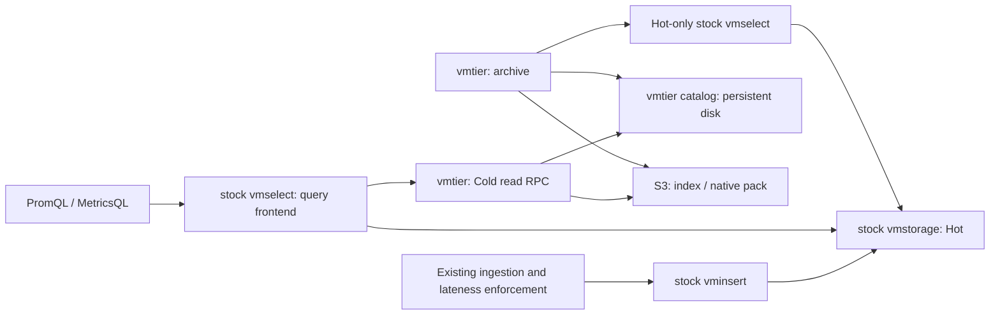

# Legacy JSON v2 MVP design and data contract

This document describes the retained JSON v2 MVP with separate archive, catalog,
and gateway processes. Start with [Current architecture](architecture.md) for the
implemented SQLite system. The current [SQLite service](serve.md) combines these owners
and adds per-stream publication and a shared S3 request budget while keeping native
pack/index v1 and the pinned VM read RPC. See [catalog migration](sqlite-catalog.md)
for cutover and the [first-release design](design.md) for implementation progress.
The limits and command architecture below belong to the legacy MVP; they do not
describe the SQLite catalog's storage or lifecycle.
The retained commands share current incremental raw verification and reader
improvements with SQLite, but the JSON v2 writer still emits one pack per window.

vmtier is an independent archiver and read gateway, not an official VictoriaMetrics product. The tested OSS cluster version is pinned to `v1.128.0-cluster`, commit `9a009c491da4c17531893ab4acb6a5f1b5e0eaf2`. See the [prior-art comparison](prior-art.md), [native gateway decision](adr/0001-native-gateway.md), and [compatibility reference](compatibility.md).

## Architecture

The top-level vmselect lists both Hot vmstorage and the Cold gateway in `-storageNode`. They provide complementary time ranges, with `-replicationFactor=1 -globalReplicationFactor=1 -search.skipSlowReplicas=false -search.denyPartialResponse=true -search.disableCache=true`. Both the reference and tiered deployments use `-dedup.minScrapeInterval=1ms`. Stock vmselect handles overlapping Hot/Cold samples, rollups, and expression evaluation. vmtier does not implement a MetricsQL evaluator or a Hot-priority rule.

The gateway does not proxy Hot reads. It uses stock vmselect's existing fan-out, avoiding a private Hot RPC client and recursive requests to a downstream vmselect. Consequently, even Hot-only queries depend on gateway and catalog availability. Partial responses that favor Hot-only availability during a Cold outage are outside the MVP contract.

S3 is the data plane and supports ordinary PUT, GET, and Range GET. The catalog is a separate control plane backed by persistent disk. Generation conflicts are resolved inside the catalog service, without conditional S3 PUT or ETags. [ADR 0002](adr/0002-independent-catalog.md) compares this choice with SQLite, PostgreSQL, and an all-S3 design.

The archiver reads only Hot-specific export endpoints with a fixed tenant and source topology. The combined query frontend and the Cold gateway must not be archive sources. A missing source shard is an error, not an empty window. Operators must ensure that every configured endpoint covers its required Hot shards; the gateway cannot discover or prove the existence of unconfigured shards.

## Time and coverage

All timestamps use UTC Unix milliseconds. Internal intervals are `[start,end)`; the inclusive end of a VM HTTP export is `end-1ms`.

| Symbol | Meaning |
| --- | --- |
| H | Archive age measured from sample timestamps, not file modification or object creation time. |
| R | The retention period during which Hot VM data remains queryable and exportable. vmtier does not change it. |
| L | The maximum delay actually accepted by upstream ingestion. Configuration alone does not enforce it. |
| Coverage | Intervals whose verification and catalog commit have completed. Only the end of their contiguous prefix is a watermark. |
| Safety margin | Finite time reserved for archiving, retries, and recovery. |

CLI configuration requires `H > L >= 0` and `R > H + safety + window`. A window is eligible only when `end <= now-H`. Its start must be later than `now-R+safety`; long archive operations check this again before committing. Cold coverage is derived from committed intervals, never inferred solely from `now-H`. A physical block spanning a boundary does not extend its logical coverage.

Ingestion must enforce bounded lateness across producer clocks, queues, retries, import, and backfill paths. Writes delayed beyond L must be rejected, and direct access to Hot VM must not bypass this policy. The configuration acknowledgement records that prerequisite; it does not observe or reject writes. A window must already be immutable while archiving. The catalog fixes H and L at the first publication and rejects writers or readers configured differently. This prevents a configuration change from reopening published windows to late writes; it does not replace ingestion enforcement.

`coverage_start_ms` is the beginning of the supported history and must be a positive window boundary. Guessing a later ingestion start excludes earlier history from completeness checks. Operators must inventory the required history when choosing this value. Cold completeness before it is not guaranteed. Contiguous coverage is calculated from this origin for every tenant and source.

## Archive transaction

1. **Select:** validate tenant/source, timestamps, age, retention, limits, and existing coverage.
2. **Export:** obtain a native export from the Hot-only endpoint. HTTP failures, timeouts, incomplete frames, and unreachable sources are errors.
3. **Check completeness:** EOF at a record boundary does not prove a native stream is complete. Compare every series, timestamp, and value from the native data, after VM's 1ms deduplication, with a separate raw matrix query that must succeed completely. Counts alone cannot detect a missing conflicting block at the same timestamp. A JSON `NaN` may correspond only to a native stale marker at that timestamp; a `stale_samples_over_time` oracle provides an additional check. Proceed only after every source passes. Empty windows also require a complete successful oracle response.
4. **Pack and upload:** generate new object keys containing a cryptographically random nonce for each attempt. Upload payload and index with ordinary PUT. Never reuse a published key. Content-MD5 checks transfer integrity; SHA-256 checks the content used by vmtier.
5. **Verify by reading back:** validate lengths, SHA-256 hashes, index, tenant, codec, and payload.
6. **Commit catalog:** submit the catalog ID and expected generation to the separate service's application-level CAS. Validate the fixed contract, complete tenant-by-source windows, and append-only transition; publish after persistence. A conflict is not success.
7. **Expose to queries:** readers select objects from a committed catalog snapshot.

The raw oracle issues `query={__name__!=""}[Nms]` at `end-1ms`. In the pinned VM version, `prometheus.QueryHandler` recognizes this range selector and calls `exportHandler(...,"promapi",...,false)`. It returns a raw JSON matrix rather than resampling at an evaluation step. An incomplete response without the successful JSON footer fails parsing. HTTP 200 alone is insufficient: the verifier checks a complete success matrix, the series set, and every timestamp and value, with no tolerance for finite values. The pinned decimal codec has a dedicated stale-marker sentinel rather than arbitrary IEEE NaN payload preservation. A non-stale NaN encountered during verification is rejected; arbitrary NaN payload round trips are not guaranteed.

This is an independent query-path check under assumptions of immutable windows, fixed topology, and correct upstream behavior. It is not a VM transactional snapshot or signed source attestation. Source replication settings must not weaken completeness by tolerating missing required shards. Differential tests against stock VM additionally check timestamps, values, and special-value semantics. Decoding native data and reading a JSON matrix add CPU, transfer, and peak-memory costs that the MVP accepts.

Replays do not republish committed windows. Retrying an unpublished window generates fresh keys, so failed uploads and losing writers may leave orphan objects without advancing coverage. After a lost commit response, the archiver rereads the authority and resumes from its state. A single writer is the deployment contract; CAS also detects accidental duplicate writers. S3 LIST, ETags, or object existence never establish publication.

The catalog is a single authority on local persistent storage. It records a stable ID, monotonic generation, fixed contract (coverage origin, window, dedup=1ms, H, L, tenants, source IDs and URL hashes), and object references. Commit uses flock, file fsync, atomic rename, and directory fsync. Explicit `catalog-init` is separate from ordinary startup so a missing state file is not mistaken for a new empty catalog. HTTP clients validate the expected ID, reject a lower generation than previously observed, and reject changed content at the same generation.

This provides neither multi-node consensus nor HA. Rollback to an old backup cannot reliably be detected after every client and server has restarted; recovery needs a new ID and an independent audit. Source URL hashes also cannot detect shard changes or resharding behind the same URL. Stop the writer and verify source completeness operationally when topology changes.

## Pack, index, and reader

Pack format v1 concatenates VM portable block bytes and uses a separate bounded JSON index. The index contains format and VM versions, tenant, logical coverage, canonical full labels, physical block times, offsets, lengths, row counts, per-block checksums, and the whole-pack checksum. Source TSIDs and MetricIDs are not persistent series identities.

Native export omits the tenant from metric names. The archive records the endpoint's account/project and restores it in wire metric names. Index identity uses the tenant and canonical full label map. Metric-name bytes returned over RPC retain VM's original tag ordering: changing them to simple lexical order would make stock vmselect treat Hot and Cold as different series.

The original payload bytes are preserved at rest, but reads decode and re-encode them. The reader first checks portable headers and expansion bounds, then uses VM's public integer codec to restore timestamps and scaled integer values. It clips samples to the logical window and builds wire blocks with `storage.Block.Init` and `MarshalData`. Adjacent packs may contain the same physical boundary block without exposing overlapping logical sample ranges. A boundary block may contain bytes for younger samples; the guarantee concerns returned samples, not the absence of all younger bytes from Cold objects.

The MVP scans a JSON series dictionary and block directory. It does not use Prometheus `tsdb/index` postings or treat VM blocks as Prometheus chunks. This is not claimed to be an optimal high-cardinality index. Pack, index, series, block, and query limits prevent unbounded materialization. Size windows before the first publication: the window is then fixed by the catalog contract. Changing it later requires an explicit migration to a new catalog, not an in-place configuration edit. Smaller windows also increase catalog entry counts.

CLI defaults are: 64MiB pack, 16MiB index, 128MiB native input, 10,000 series and 100,000 blocks per pack, 512KiB portable block, 64KiB native metric name, and 5,000,000 expanded verification samples. The JSON catalog is limited to 10,000 entries and 16MiB. The retained gateway shares current query admission: 128MiB logical work per query and 256MiB shared by default, a 100,000-block limit, eight active RPCs without queueing, and a 30s request limit. These allowances are not a process memory limit; see [memory accounting](query-memory.md). Automatic pack splitting is unavailable to the JSON v2 writer; exceeding a bound is an error. The [SQLite writer](archive-packs.md) supports bounded rotation within one window.

Candidate selection uses the actual storage RPC time range and label matchers calculated by vmselect, not just the frontend HTTP `start/end`. Stock vmselect expands history requirements for range vectors, offsets, subqueries, and `@`. Matching for `=`, `!=`, `=~`, `!~`, and absent/empty labels follows VM's regex implementation. Cold metadata is derived from the same committed data.

The S3 reader uses the block directory for Range GETs and validates length, Content-Range, and SHA-256, independently of ETags. Cache keys include tenant and immutable object/checksum/range identity. A cached catalog success cannot substitute for an unavailable authority. Read retries and timeouts are finite. Publication waits until a GET returns the expected uploaded content; missing objects after publication are errors. The retained gateway now shares the [byte-bounded LRU, identical-miss sharing, and adjacent-range reads](reader-validation.md) with SQLite; the historical measurements describe the reader at their recorded revision.

## Failures and resources

Missing objects, unsupported codecs, tenant mismatches, corruption, S3 failures, and resource-limit violations produce query errors. Bounded search completes before the upstream server sends a success prefix, so discovering corruption does not turn a failed query into an empty success. The top-level vmselect must also deny partial responses.

The gateway uses `vmselectapi.Server` concurrency/queue limits and request deadlines. Backend I/O is bounded by context. The public API does not expose the RPC request context or immediate client cancellation, so a disconnect does not guarantee immediate cancellation of all S3 work; the deadline bounds it.

A query continues reading the objects in its selected catalog snapshot. Catalog updates retain existing entries, and the MVP deletes neither published objects nor orphans, so concurrent updates do not introduce a garbage-collection race. Ordinary S3 PUT does not enforce immutability. Correctness depends on vmtier never reusing published keys and operators preventing external modification or deletion. This is a capacity-growth limitation, not an implemented GC policy.

## Guarantees outside the MVP

Stock VM retention does not consult the external catalog or archive watermark. Hot expiration continues during an archive outage, so data preservation cannot be guaranteed through an indefinite outage. Archive and recovery must finish within the safety margin, all required history must remain queryable/exportable at adoption, and separate recovery copies may be needed. Do not count physical parts still present on disk as extra time: `storage.Search.NextMetricBlock` filters blocks older than retention.

vmtier does not delete Hot data or shorten its retention automatically. VM's `delete_series` is not an arbitrary time-range deletion API. E2E tests replace a disposable Hot cluster with recent-only data and confirm that Cold-only selectors are empty on Hot; they do not wait for natural expiration.

Late-write correction, backfill, deletion, tombstones, Cold retention enforcement, compaction, and GC are not automatically managed. Gateway write/delete RPCs return errors. Direct Hot operations cannot be rejected or detected by the gateway. See [operations](operations.md) for deployment requirements.
